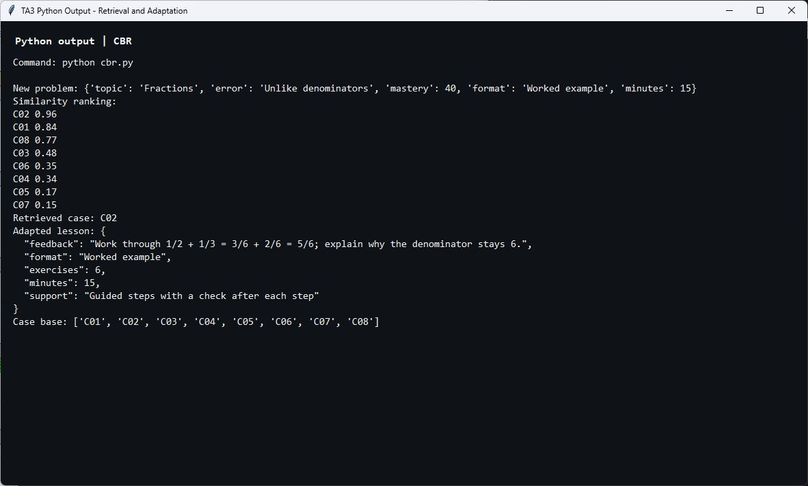
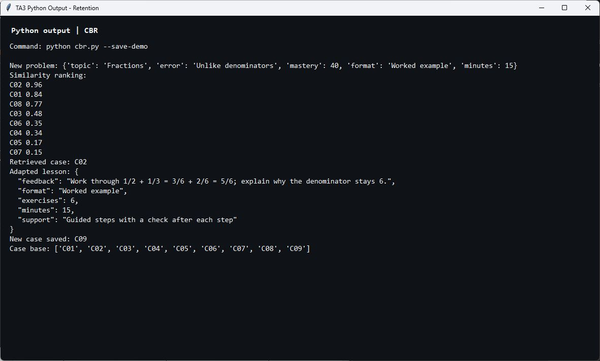

# Technical Assessment 03 — Case-Based Reasoning Tutor

A simple Python math tutor that retrieves a similar past case, adapts its lesson, and retains a reviewed new case.

**Students:** Ken Dylen R. Fernando & Nadine Love Ramos

**Section:** AN43

**Instructor:** Crisola Tan

**Date:** October 31, 2026

## Files

```text
Technical-Assessment-03/
├── .gitignore
├── README.md
├── python/
│   ├── cbr.py
│   └── seed_cases.json
├── docs/
│   ├── TA3_Fernando_Ramos.doc
│   └── TA3_Fernando_Ramos.docx
└── screenshots/
    ├── 01_retrieval_and_adaptation.png
    └── 02_retention_and_updated_cases.png
```

The report is included in the original Word format and as a DOCX copy. The screenshots show actual output from fresh demo runs.

## Run

Install Python 3.6 or later. The program uses only the Python standard library; no additional packages are needed.

From this assessment folder:

```powershell
cd python
python cbr.py
```

To demonstrate retaining a reviewed case:

```powershell
python cbr.py --save-demo
```

The retention demo uses a fictional outcome and saves C09 in a local `cases.json`. Repeating the same demo review does not save a duplicate. The local case base is excluded from Git. To restart with the eight seed cases, remove the generated `python/cases.json`.

## CBR processes

- **Representation:** JSON cases contain a problem, lesson solution, and outcome.
- **Retrieval:** Similarity combines topic (30%), error (35%), mastery (20%), and lesson format (15%).
- **Adaptation:** The lesson adjusts support, exercise count, format, and time to the new learner's needs.
- **Retention:** A reviewed lesson with improved mastery is saved as a new case.

For the supplied example, C02 has a similarity of 0.96. Its lesson is adapted to six exercises in 15 minutes, with guided steps.

## Output screenshots

### Retrieval and adaptation



### Retention and updated case base


